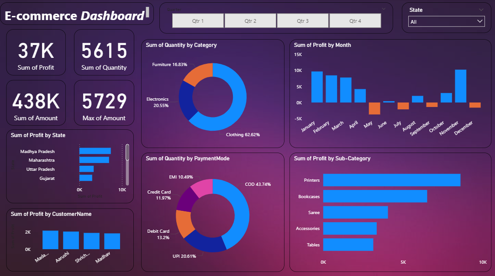

# E-commerce Sales Dashboard | Power BI

## Project Overview
This project presents an interactive E-commerce Sales Dashboard developed using Microsoft Power BI. It helps analyze sales performance, profitability, product categories, payment methods, customer contributions, and state-wise performance.

## Tools Used
- Microsoft Power BI
- Data Visualization
- Interactive Slicers and KPI Cards

## Key Performance Indicators
- **Total Profit:** 37K
- **Total Amount:** 438K
- **Total Quantity:** 5,615
- **Maximum Amount:** 5,729

*Note: KPI labels and units should be verified against the source data.*

## Dashboard Features
- Monthly profit analysis
- Quantity distribution by product category
- Payment mode analysis
- Profit by state
- Profit by sub-category
- Customer-wise profit analysis
- Interactive quarter and state filters

## Key Observations
- Clothing accounts for the largest share of quantity at approximately 62.62%.
- COD represents approximately 43.74% of quantity by payment mode.
- Printers lead the displayed sub-categories in profit.
- Monthly profit varies, with both positive and negative months.

## Business Recommendations
- Investigate the reasons for negative monthly profit.
- Analyze the profitability of high-performing product sub-categories.
- Review payment-mode trends to support better payment and order management.
- Compare state-wise performance to identify opportunities for growth.

## Dashboard Preview

## Author
Simran Siddiqui

[GitHub Profile](https://github.com/SimranSiddiqui1705)
